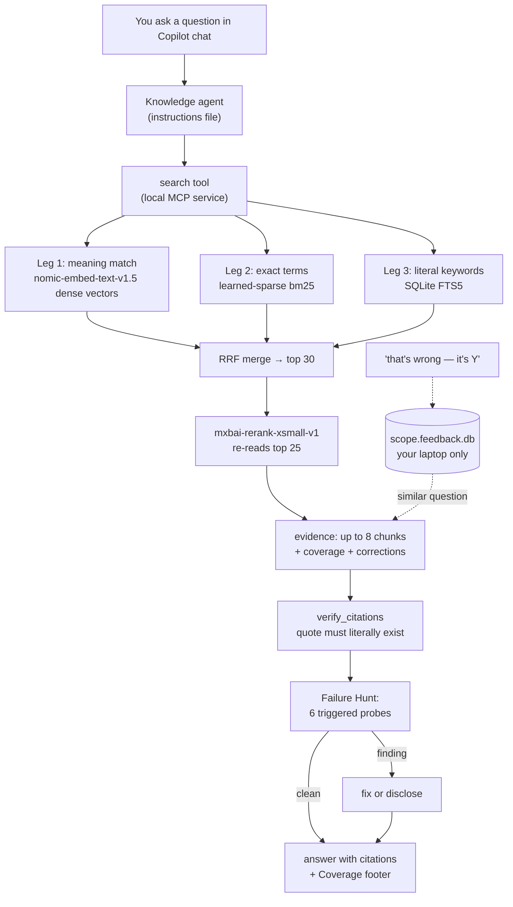

# Knowledge Agent — KT Guide for the Technical Lead

Read this once and you can explain *why* and *how* every part of this system
works — to an executive, an auditor, or an engineer — without being an AI
specialist.

Three services, one engine: `confluence-knowledge` (Confluence pages),
`sharepoint-knowledge` (SharePoint sites/libraries), `local-knowledge`
(files/folders). Everything below applies to all three; differences are
called out.

Each feature is explained in three layers — **Simple** (the analogy),
**Technical** (the implementation, terms defined on first use), and a
**Real-world example** — followed by **Verify it yourself**: the exact
command or file where you can check the claim hands-on.

---

## The journey of a question — process map



Reading the map: everything inside the box is on **your laptop**. The only
external calls are `GET` requests to fetch your docs during a crawl and the
Copilot model that writes the final prose — the same Copilot you already
have approved.

---

## Deep-Dive 1 — The Ingestion Process

### Simple

Think of a librarian you hire to answer questions about your company's
handbook. Before answering anything, the librarian reads *every page of
one shelf you point at* — not the whole library, just the shelf you
chose — and keeps their own annotated index of it. When you ask a
question, they never rely on memory; they look things up in their index
first.

### Technical

- **Recursive crawl.** `connect` takes one root (a Confluence page URL,
  a SharePoint site URL, or a local folder path). A background `Crawler`
  does a breadth-first walk (`start_crawl` → repeated `crawl_step` polls)
  over every reachable descendant, checkpointing progress per page into
  the SQLite index — an interrupted crawl resumes, and a server restart
  picks the job back up. Confluence: `v2 direct-children` (Cloud) or
  `rest/api/content/{id}/child/page` (DC); folders are walked too.
  SharePoint: Graph `site → Site Pages list + every document drive →
  item children`. Local: recursive filesystem walk.
- **Cloud vs. Data Center auth.** Atlassian runs two incompatible REST
  surfaces and the profile's `env` picks the right one:
  - **Cloud** — URL must end in `*.atlassian.net`; auth is
    `Basic base64(email:token)`. Scoped API tokens can instead be routed
    through `api.atlassian.com/ex/confluence/{cloudId}` — the client
    targets that gateway base, keeping the same v2 routes.
  - **Data Center** — a self-hosted URL + `Bearer <PAT>` header.
  - **SharePoint** — Microsoft Graph with MSAL **device-code** sign-in
    (delegated `Sites.Read.All`; one interactive login, then silent
    refresh from the OS keyring). `SP_KNOWLEDGE_TOKEN` exists for CI.
  - **Local** — no credentials at all.
- **Local-first storage.** Everything lives under `~/.<app>/`:
  `venv/` (the service), `models/` (pinned ONNX snapshots), and
  `<workdir>/.<app>_index/` — one SQLite file per scope key
  (site+account+root for Confluence; path hash for local; site+account+
  root item for SP). Secrets stay in the OS keyring; nothing index-
  related lands in your repo.
- **Writes are impossible.** The client's `request()` rejects any non-GET
  method *before* any socket I/O and checks every path against a
  per-environment route allowlist — so a corrupted prompt or a malicious
  page can't make the agent write, delete, or POST anywhere.

### Real-world example

You connect to the root page "Platform Engineering Handbook" → the
crawler follows `direct-children` links through 32 pages including the
"Deploy Windows" child. On a flaky VPN, page 20 times out — the crawl
resumes where it left off, and `crawl_step` reports `pages_seen`
climbing. A folder named `prod.pem` / a file named `id_rsa` is skipped
with a disclosed warning instead of being indexed.

### Verify it yourself

```bash
~/.confluence-knowledge/venv/bin/confluence-knowledge doctor
# green flags → deps, models, registration, index health
ls ~/.confluence-knowledge/work/.conf_knowledge_index/  # one <scope>.db per root
```

---

## Deep-Dive 2 — Table-Aware Chunking ("row-atomic splitting")

### Simple

Imagine a 900-row spreadsheet printed as one gigantic page. If you
photocopied chunks of it without the column headers, the person reading
page 30 would see `svc-0800  tcp/10800` with no idea which number is the
port. We do the opposite: every photocopied piece of the table **repeats
the column headers**, and a row is never torn in half.

### Technical

- **Serialization.** `_table_to_text` flattens an HTML/Office table into:

  ```
  Table — columns: Service | Port | Owner
  row 1: svc-0001 | tcp/8001 | payments
  row 2: svc-0002 | tcp/8002 | billing
  ```

  Row order is preserved; `<th>`-less tables keep their first row as
  both the columns line and row 1 (never eaten as a header);
  `colspan`/`rowspan` values carry into the cells they cover.
- **Row-atomic splitting.** If the serialized table exceeds the
  chunk budget (448 model tokens when the tokenizer is available, else
  280 words), `split_table_text` emits row-group segments —
  **each segment starts with the same `Table — columns:` header**. A row
  is never split mid-row, so the `Field → Value` relationship survives in
  every chunk's vector.
- **Why it mattered.** A 43 KB single-chunk table meant rows past the token
  ceiling were *embedded but never retrievable* — the classic silent
  failure. Splitting by rows keeps the whole table findable.
- **Everywhere.** `extract_files.py` reuses the same function for docx,
  xlsx, csv, and pptx tables.

### Real-world example

The corpus has a 900-row "Big Reference Table" page. Query:
*"what port does svc-0800 use?"*

- **Before:** one huge chunk → embedder truncated the tail → reranker
  never saw row 800 → answer: *"not documented."* Confidently wrong.
- **After:** the row-800 chunk carries `columns: Service | Port | …` +
  `row 800: svc-0800 | tcp/10800 | infra` → retrieved, cited, correct.

### Verify it yourself

```bash
# the golden set has the exact regression:
grep svc-0800 mcp/confluence-knowledge/tests/rag/golden.json
# and the real-model eval proves it end-to-end (run from mcp/confluence-knowledge):
CK_MODEL_HOME=~/.confluence-knowledge python scripts/eval_rag.py
```

---

## Deep-Dive 3 — The Retrieval Pipeline ("hybrid → rerank")

### Simple

Three librarians work the question in parallel, then a senior one
decides:

- The **meaning librarian** finds pages that *talk about* your topic even
  if the words differ — "reset credentials" ≈ "forgotten password."
- The **term librarian** cares about exact strings — `ERR-X99`, a ticket
  key, a service name — the rare identifiers the meaning librarian blurs.
- The **keyword index** is plain Ctrl+F — literal substring backup.
- Their three shortlists merge fairly (each contributes a rank, not a
  raw score), and the **senior librarian** re-reads the top candidates
  one by one and keeps only what actually answers the question.

### Technical

- **Dense leg** — `nomic-embed-text-v1.5` quantized ONNX (~137 MB): every chunk → a
  768-dimensional normalized *vector* (a point in "meaning space");
  questions get vectors too; nearest points by *cosine similarity* (angle
  between vectors — identical direction ≈ 1.0) come back.
- **Sparse leg** — `Qdrant/bm25` learned sparse embeddings via fastembed:
  each chunk/query → `{term_id: weight}` where rare terms weigh more.
  *(Honest engineering note: every public ONNX export of nomic-embed-text-v1.5 drops its
  lexical head, so the sparse leg uses bm25 — same role, ONNX-native.)*
- **FTS leg** — SQLite FTS5 `MATCH`, first 16 whitespace terms, per-word
  quoting so punctuation can't break the query.
- **Fusion** — Reciprocal-Rank Fusion: each leg contributes
  `1/(60 + rank)` per result; the sum produces a top-30 candidate list.
  Score scales differ wildly between legs, so rank (position) is merged,
  not score.
- **Reranker** — `mxbai-rerank-xsmall-v1` cross-encoder (a model that reads
  *question+chunk together* and outputs a relevance score — unlike the
  fast legs, it sees both sides at once) re-scores the top 25:
  - `≥ 0.3` → confident evidence
  - `0.02–0.3` → returned, flagged `low_confidence: true` (the agent
    must caveat)
  - `< 0.02` → dropped — below the noise floor it would ground the
    answer on "least-bad" junk
- **Grounding** — evidence is capped at 8 chunks / 12 000 chars each
  (`truncated` flag tells the agent to fetch full text via
  `get_evidence`). Empty evidence → the prescribed refusal, verbatim.

### Real-world example

Question: *"vpn drops every hour"*

- Dense finds the "Troubleshooting VPN" page by meaning.
- Sparse + FTS catch the literal `3600s` timeout figure.
- RRF puts the right chunk in the top 25; the reranker scores it ~0.98
  → it lands as evidence #1. Answer: *"Session timeout defaults to
  3600s; raise it via IT."* — cited.

### Verify it yourself

```bash
cd mcp/confluence-knowledge && CK_MODEL_HOME=~/.confluence-knowledge python scripts/eval_rag.py
# recall@8: 20/20 (100%)  ·  honesty: 4/4  ·  p50 latency ~2-4 s
```

---

## Deep-Dive 4 — The Failure Hunt (six probes)

### Simple

Before signing off, a proofreader tries to *break* the answer instead of
just re-reading it: checks the first and last pages of a long document
(tails get lost), googles the exact error code (rare strings get blurred),
confirms two-part answers really used two sources, and calls out where
two documents disagree.

### Technical

After `verify_citations` passes (every quote literally present in the
cited chunk, normalized for smart quotes/NBSP/dashes), the agent runs
trigger-gated probes — each costs one extra tool call only when its
trigger applies:

| Probe | Trigger | What it catches |
|---|---|---|
| **Boundary test** | answer relies on a very long page or `truncated: true` | fetches the page's FIRST + LAST chunks; missing tail → indexing truncation → re-answer from full text |
| **Keyword stress** | query has a rare ID (ticket key, `ERR-X99`, hostname) | bare-ID `search` must outrank paraphrases; if the exact ID vanishes while prose survives → sparse-leg recall gap |
| **Cross-page synthesis** | question needs facts from >1 page | every claim landing on one page → `Recall Gap` + the missing page is named |
| **Contradiction** | same term on multiple pages (dupes, versions) | conflict must be *cited* — prefer newest `as_of`, never silently pick one |
| **Table-Probe** | claim from a `kind=table` chunk | re-search the row's terms; cell pulled from an adjacent row → `Table mismatch` |
| **Feedback check** | `user_corrections` came back in search | the saved correction must be disclosed — never silent, never overriding |

Findings go in the **Coverage footer** — either fixed before the answer
or disclosed there, never hidden.

### Real-world example

*"When are production deploys, and when does the freeze start?"* — the
answer finds the "Deploy Windows" page. The Boundary + Synthesis probes
check the freeze window is on the same page (it is — the `info` macro
carries it). If the freeze lived on a separate "Change Calendar" page,
the hunt would flag a `Recall Gap` and the footer would name it.

### Verify it yourself

Read the probe table in any of the three agent files (`agents/*-knowledge.agent.md`,
§"Answer" step 5) — it's instructable English, and you can watch a live
run surface a `low_confidence` flag or a correction disclosure in chat.

---

## Deep-Dive 5 — The Learning Loop (feedback)

### Simple

A sticky note on *your own copy* of the manual. You write "this page is
wrong, it's actually Y" — next time you ask that question, the librarian
reads the manual's answer **and** your sticky note aloud. The note never
replaces the printed text — it sits beside it, dated, so you can judge
both.

### Technical

- **Storage** — `submit_feedback(scope, question, correction, note)`
  embeds the question with the same nomic-embed-text-v1.5 embedder and appends
  `{id, question, qvec, correction, note, ts}` to
  `<index_root>/<scope>.feedback.db` (SQLite WAL — concurrent writers
  can't lose corrections). A legacy `.feedback.json` migrates on first open.
  tolerant load (corrupt file → empty + continue, never a crash), and
  `clean` removes it with the index.
- **Injection** — `search` embeds your new question and cosine-matches
  the stored `qvec`s. Matches ≥ **0.75** ride along in the response as
  `user_corrections` — part of the tool output, so the agent can't skip
  it.
- **The 0.75 threshold, measured on the real model**: identical question
  = 1.00 · close paraphrase ≈ 0.77 · same-topic different-intent ≈ 0.68 ·
  unrelated ≈ 0.39. So paraphrases surface the correction; related but
  different questions don't leak it.
- **Never override** — a saved correction can be stale or wrong itself,
  so the mandated disclosure format is *"the docs say X, but a saved
  correction (dated N days ago) notes Y."* Baseline documentation always
  stands; the correction annotates.
- **Scope** — the file lives inside the per-scope index dir, on your
  machine: **no sharing, no sync** — a colleague's corrections never
  reach your answers (that was an explicit design/accuracy choice).
- **Doc health** — `feedback_report` lists recurring corrections; the
  agent infers *which* page keeps getting corrected from context and
  suggests it to you — it cannot notify the owner (read-only client) and
  never writes back to Confluence/SharePoint.

### Real-world example

Docs say the maintenance freeze starts Dec 20; IT moved it to Dec 15 and
hasn't updated the page.

- You say: *"that's wrong — it's Dec 15."* → `submit_feedback` stores it.
- Next week you ask *"when can we deploy?"* — different words, cosine
  0.77 → the answer cites the docs **and** discloses your correction with
  its age.
- `feedback_report` → "freeze-window questions keep getting corrected"
  → you tell the docs owner to fix the page. Loop closed, manually.

### Verify it yourself

```bash
# the e2e exercises exactly this path against a fake server:
cd mcp/confluence-knowledge && python scripts/e2e_bootstrap.py --service .
# PASS submit_feedback stores a correction
# PASS search auto-discloses matching correction
```

---

## Deep-Dive 6 — The Evaluation System ("proving it works")

### Simple

An exam with a known answer key. We built a small set of questions whose
perfect answers we already know ("the gold set"), run the agent through
the exam on the real pipeline, and grade it mechanically — so a retrieval
change can't silently make answers worse. On top, a second "teacher"
(Copilot itself — you can even pick a different model tier) audits
factuality and completeness.

### Technical

- **Golden set** — `golden_set.json` pairs of
  `{question, ideal_answer, required_pages, required_facts,
  expect_no_answer}` — including table lookups, near-duplicate
  disambiguation, and deliberate no-answer traps.
- **Deterministic scoring** — `eval_rag.py --golden <set> [--index
  <live.db>]` produces recall@8 (did the right page surface?), fact
  coverage (are the required strings in evidence?), honesty (do
  no-answer questions return empty?), and p50/p95 latency. Below
  thresholds → non-zero exit → the CI gate fails the build inside the
  bootstrap e2e.
- **Copilot-as-judge** — `prompts/rag-judge.prompt.md` in two modes:
  *standalone* (the agent runs the golden set itself and self-audits)
  or *hybrid* (audits `eval_report.json` → `judge_verdicts.json` →
  `eval_rag.py --merge-verdicts`). The rubric: factuality /
  completeness / groundedness — verdicts `correct|partial|wrong|
  no_answer`.
- **Why two scorers**: the deterministic metrics gate CI (repeatable,
  free); the LLM judge catches subtleties the string-matching can't —
  e.g., an answer that retrieved the right page but phrased it
  misleadingly.

### Real-world example

The table-splitting fix (#103) moved `svc-0800` from *miss* to *hit*:
golden-set recall went 17/20 → 20/20 on the same eval run. If a future
model change dropped recall below 80%, the e2e job would fail before the
release could ship.

### Verify it yourself

```bash
cd mcp/confluence-knowledge && CK_MODEL_HOME=~/.confluence-knowledge \
    python scripts/eval_rag.py --golden scripts/golden_set.sample.json \
    --index ~/.confluence-knowledge/work/.conf_knowledge_index/<scope>.db
# or run the Copilot judge on eval_report.json via prompts/rag-judge.prompt.md
```

---

## Cheat-sheet — where to look

| Feature | Code | See it yourself |
|---|---|---|
| Crawl + env auth | `src/confluence_knowledge/crawl.py`, `client.py`, `auth.py` | `doctor`, first-run connect |
| Table splitting | `extract.py::split_table_text`, `extract_files.py` | golden pair "svc-0800" |
| Hybrid retrieval | `retrieval.py::retrieve` | `eval_rag.py` output |
| Reranker tiers | `retrieval.py` (0.02 / 0.3) | `low_confidence` in search output |
| Failure Hunt | `agents/*-knowledge.agent.md` §Answer | live chat turn |
| Feedback loop | `feedback.py`, `search` response field | `submit_feedback` → paraphrased `search` |
| Golden eval | `scripts/eval_rag.py`, `tests/rag/golden.json` | run it |

## Glossary

| Term | Plain meaning |
|---|---|
| **Embedding / vector** | text → a fixed list of 384 numbers; similar meaning → similar numbers |
| **Cosine similarity** | how aligned two vectors are (1.0 = same direction = same topic) |
| **Sparse embedding (bm25)** | per-word weights — rare IDs carry the signal |
| **FTS5** | SQLite's built-in keyword index — literal term match |
| **RRF** | merge three ranked lists by position, not raw score |
| **Cross-encoder reranker** | a model that reads question+chunk together and scores the pair |
| **Chunk** | a ~448-token piece of a page (word-bounded offline) — the unit that gets embedded and cited |
| **Scope** | one root (page/site/folder) + its descendants + your credentials — its own index and feedback store |
| **MCP** | the protocol Copilot uses to call the local service's tools |
| **`low_confidence` / `truncated` / `user_corrections`** | honesty flags on evidence — the agent must disclose, not hide |
