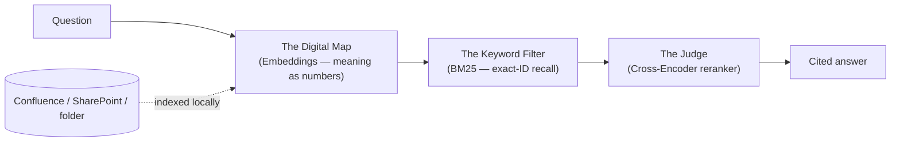
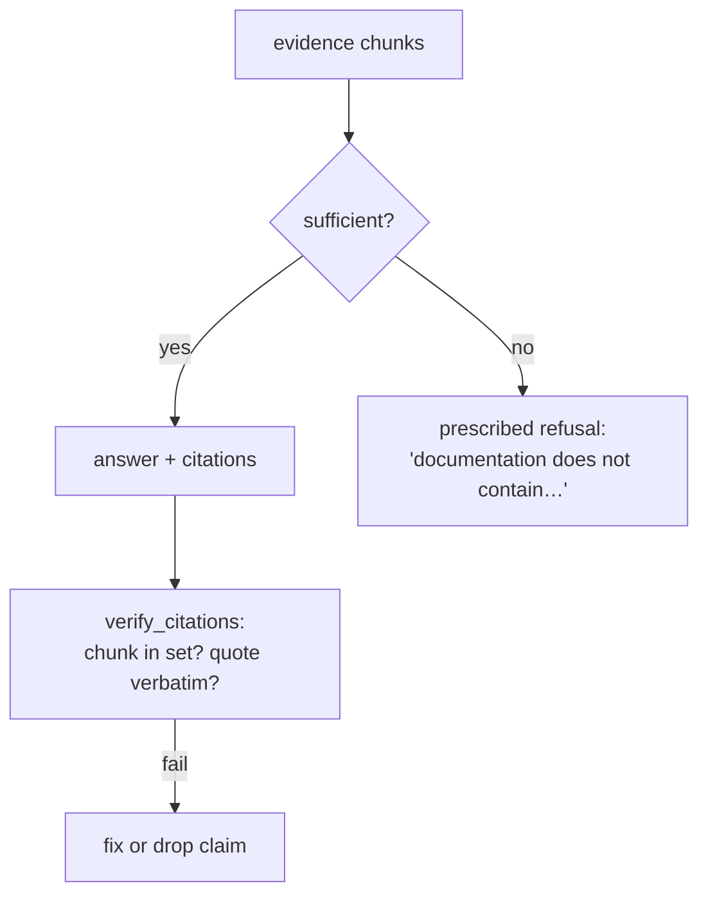

# The Knowledge Agent
## A Corporate Truth Machine

Instant, **cited**, verified answers from *your* documentation —
Confluence, SharePoint, or a local folder — indexing and retrieval run
100% on your laptop; answers are composed by the Copilot model you
already use.

*Leadership: this is about lost time and wrong answers.*
*Engineering: this is about grounding, not vibes.*

---

# Section 1 — The Value Proposition
## Why this exists

---

## The Documentation Nightmare

- Thousands of pages across Confluence + SharePoint — runbooks, policies,
  decisions, tribal knowledge
- Native search finds **documents**, not answers
- Two docs say different things — nobody knows which is current
- Every question = interrupt a senior engineer, or read 12 pages yourself

> The answer exists on a page nobody can find — and the AI we already
> have can't read it.

---

## The Solution

**One Copilot agent.** Point it at a docs root. It reads everything
underneath, keeps a local index, and answers:

- **Every claim cited** — click through to the exact source page
- **Says "I don't know"** — instead of guessing
- **Flags its own confidence** — weak matches are labelled, not hidden
- **Learns from corrections** — your fixes surface next time

---

## The Key Business Wins

| Win | Why leadership cares |
|---|---|
| **Zero-risk security** | Index, embeddings, and retrieval run entirely on-device — no new external service; the only LLM involved is the Copilot you already have approved. Read-only by construction |
| **Instant onboarding** | New engineers get *the* answer in seconds instead of days of asking around |
| **Documentation health** | Corrections aggregate per scope — the agent can identify which page keeps getting corrected and recommend it to the docs owner; the fix itself stays human |
| **No added inference cost** | Local models do the retrieval work — no extra per-query API spend beyond your existing Copilot seat |

---

# Section 2 — The Intelligence Engine
## Simple analogy → technical term



---

## The Open-Book Exam — RAG

**Simple:** The agent never answers from memory. Every question → it
fetches the real pages, reads them, and answers *only* from what it
found — like an open-book exam where quoting the wrong page fails.

**Technical:** *Retrieval-Augmented Generation.* The model's context is
filled with retrieved evidence chunks; generation is conditioned on
that, not on parameters trained on the public internet.

---

## The Digital Map — Embeddings

**Simple:** Words get turned into coordinates on a giant map of meaning.
"Reset credentials" lands next to "forgotten password" — even though zero
words overlap — because they *mean* similar things.

**Technical:** `bge-m3` — 1024-dimensional dense vectors, multilingual
(100+ languages), quantized ONNX, runs locally (~570 MB). Every chunk of
every page gets a vector; questions get vectors; we fetch by cosine
distance.

---

## The Keyword Filter — Sparse / Hybrid Search

**Simple:** Semantic maps blur the difference between `ERR-X99` and
`ERR-X98`. A second search leg treats tokens literally — like Ctrl+F,
but smarter — so exact error codes, ticket keys, and service names
*always* surface.

**Technical:** `Qdrant/bm25` learned sparse embeddings + SQLite FTS5,
fused with the dense leg via reciprocal-rank fusion (`1/(60+rank)` —
three legs, incomparable score scales, rank solves it).

---

## The Final Quality Check — Reranking

**Simple:** The first pass gets ~30 candidates fast. A dedicated "judge"
model then reads each candidate *against the question* and scores it —
the final top-8 is what the answer is built on.

**Technical:** `bge-reranker-v2-m3` cross-encoder. Measured tiers:
`≥0.3` confident · `0.02–0.3` returned + flagged `low_confidence` ·
`<0.02` dropped (never grounds an answer on noise).

---

# Section 3 — The Trust & Safety Layer
## The industrial features

---

## The "No-Delete" Guarantee

**Simple:** The agent is *physically incapable* of editing your docs —
not "chooses not to," **cannot**.

**Technical:** `ConfluenceClient.request()` rejects every non-GET method
*before any network I/O*; paths must pass a per-environment route
allowlist; redirects never followed; `..` traversal refused. Same shape
for SharePoint (`Sites.Read.All` + GET-only Graph allowlist — verified
in e2e that downloads carry no auth header).

---

## The "No-Hallucination" Shield

**Simple:** If the answer isn't in the docs, the agent says exactly that
— it will not guess.

**Technical:** *Closed-world assumption.* Empty/weak evidence → the
prescribed refusal. Every claim → `[Source: title](url)` →
`verify_citations` proves each quote is literally present in the cited
chunk (normalized for smart quotes/NBSP).



---

## The "Anti-Error" Loop — Failure Hunt

**Simple:** Before answering, the agent tries to *break* its own answer.

**Technical:** Six trigger-gated probes between citation check and reply:

| Probe | Catches |
|---|---|
| Boundary | truncation of long pages (fetch first+last chunk) |
| Keyword stress | rare-ID queries vanishing vs. paraphrases |
| Cross-page synthesis | answers that only found one of two needed pages → `Recall Gap` |
| Contradiction | same term, conflicting pages — cite the disagreement |
| Table-Probe | cells pulled from the wrong row of a big table |
| Feedback check | a saved correction exists → must disclose it |

---

## The Learning Brain — Feedback Loop

**Simple:** Tell the agent "that's wrong, it's actually Y." Next time
*you* ask that question on this machine, it discloses your correction
*alongside* the official text — and repeats keep flagging which pages
are outdated.

**Technical:** `submit_feedback` stores the question's embedding +
correction per-scope (`<scope>.feedback.json`); `search` auto-injects
matches at cosine ≥0.75; `feedback_report` aggregates → "these pages
look stale." Corrections **annotate** — never override.

---

# Section 4 — The Proof

---

## The Golden Set — "Accuracy Score"

A curated set of `{question → ideal answer → required pages/facts}`
pairs runs through the *real* pipeline:

- **Recall@8** — did the right page make the evidence set? **20/20**
- **Fact coverage** — are required facts present? **100%**
- **Honesty** — no-answer questions stayed empty: **4/4**
- Gated in CI — no model/retrieval change ships below threshold

And a **Copilot-as-judge** prompt audits factuality, completeness,
groundedness on top of the deterministic metrics.

---

## Before vs. After

**Standard AI:**
> "Deploys typically happen midweek in most organizations."

**Knowledge Agent:**
> "Production deploys happen only on Thursdays after 18:00.
> [Source: Deploy Windows]
> *Coverage: 32 pages · indexed 14:02 · Failure Hunt: clean*
> *Note: a saved correction (2 days ago) notes the freeze now
> starts Dec 15, not Dec 20.*"

Same question. One is a plausible guess. One is provable.

---

# Section 5 — The Call to Action

---

## Get it

```bash
pipx install confluence-knowledge   # or local-knowledge / sharepoint-knowledge
confluence-knowledge setup          # token + models (~1.5 GB, once)
confluence-knowledge register       # wire into your IDE
```

Then in Copilot chat: *"Connect to the Platform docs space and answer
questions about it."*

---

## Contribute — the Golden Set

- Found a wrong/slow answer? Add a `{question, ideal_answer,
  required_pages}` pair to `golden_set.json`
- Your corrections stick — same question on your machine gets the
  disclosure next time; `feedback_report` shows which question keeps
  getting corrected — point the docs owner at it
- `submit_feedback` — say "that's wrong, it's X" in chat; it sticks

---

## Roadmap

- Golden-set coverage per team space (each org adds its own pairs)
- `feedback_report` aggregation → quarterly doc-health review
  (which topics keep getting corrected)
- Richer table fidelity (cell-level provenance), OCR for embedded images
- Org-wide shareable golden sets (reviewed, versioned)

---

# Questions?

Three flavors — same engine:
**confluence-knowledge** · **local-knowledge** · **sharepoint-knowledge**

*Local-first. Cited. Honest about what it doesn't know.*
