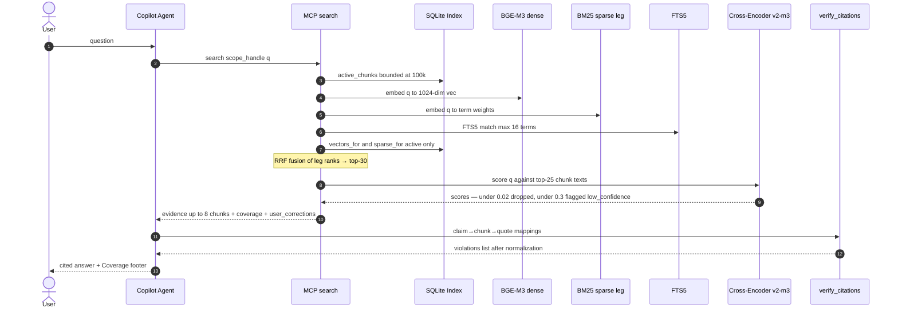
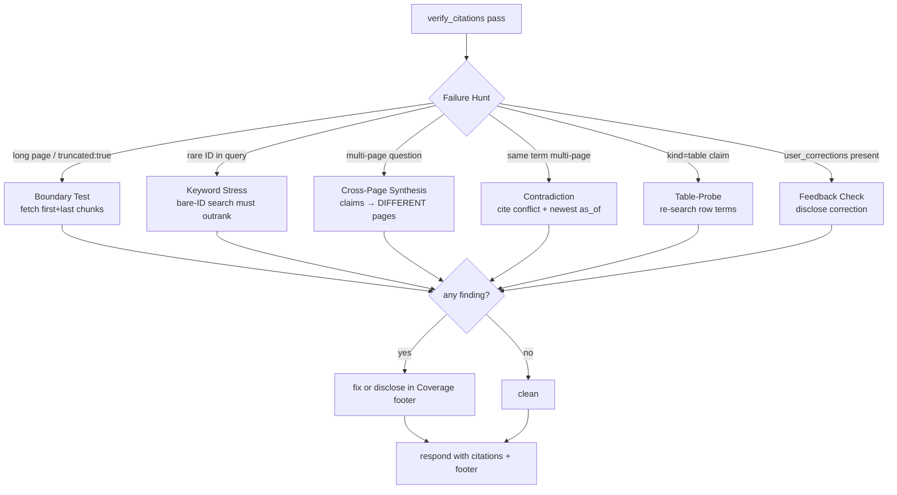
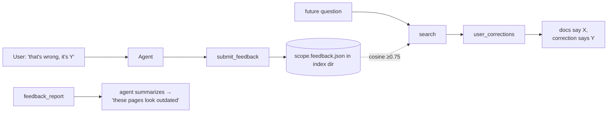
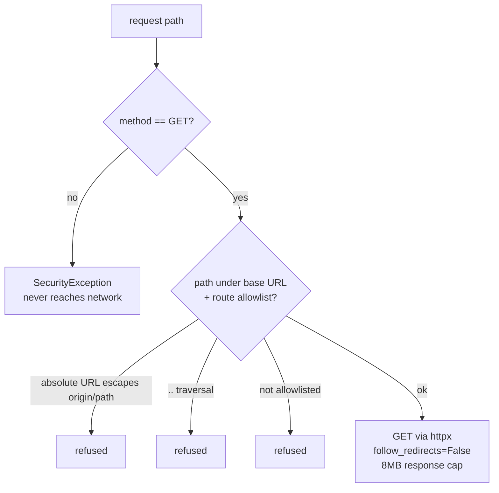
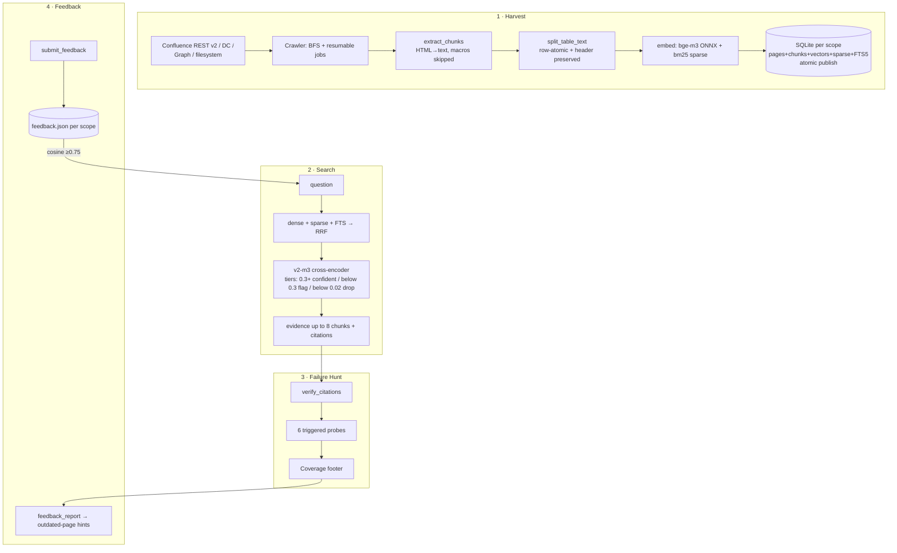

# Knowledge Agent — Technical Design Document

Architectural specification for the `confluence-knowledge`,
`local-knowledge`, and `sharepoint-knowledge` services — three Python MCP
servers sharing one retrieval engine (`confluence_knowledge.*`), each
surfacing an identical 9-tool surface to a Copilot agent.

Scope labels used throughout: `CK` (Confluence), `LK` (local files),
`SP` (SharePoint).

---

## 1. Data Ingestion Pipeline — "The Harvest"

### 1.1 Discovery & environment detection

| Component | Problem it solves |
|---|---|
| `SiteProfile.env` (`cloud` \| `datacenter`) | Atlassian exposes two incompatible REST surfaces — `wiki/api/v2` (Cloud) vs `rest/api` (Data Center). The profile selects the correct route family and auth scheme. |
| `Crawler` BFS queue | Recursive descent from a user-chosen root; parent→child edges recorded so evidence carries `level` and hierarchy context. |

The crawl is a resumable breadth-first walk driven interactively —
`start_crawl` returns a `job_id`, and the agent polls `crawl_step`
(incremental steps so the MCP call never blocks on thousands of pages):

- **CK Cloud** — `wiki/api/v2/pages/{id}/direct-children` (+ folders);
  `…/pages/{id}` for bodies. Auth: `Basic base64(email:token)`; optionally
  routed through `api.atlassian.com/ex/confluence/{cloudId}` for scoped
  tokens.
- **CK Data Center** — `rest/api/content/{id}/child/page` + fetch via
  `rest/api/content/{id}?expand=body.storage,version`; `Bearer <PAT>`.
- **LK** — recursive filesystem walk over a folder/file; secrets-looking
  names (`*.pem`, `id_rsa`, `.env`, `*.key`, `*.p12`, etc.) are skipped and
  *disclosed* as warnings rather than silently indexed.
- **SP** — Graph `sites/{id}` → Site Pages list + document libraries →
  item children; file bytes downloaded via Graph `downloadUrl`
  **without** the Bearer header (per-drive SAS URL — verified by e2e).
  Auth = MSAL device-code, `Sites.Read.All` delegated, token cache in the
  OS keyring with silent refresh.

### 1.2 Row-atomic table splitting

| Component | Problem it solves |
|---|---|
| `_table_to_text` | Converts `<table>` DOM into a structured text form where the row/column relationship survives embedding. |
| `split_table_text` | An oversized table's tail rows were *unfindable*: one giant chunk exceeded the embedder and reranker windows, so BGE-M3 never "saw" rows past the cutoff. Row-group splitting with header preservation keeps every row retrievable; chunking is token-aware (448-token budget) when the embedder's tokenizer is available, word-based otherwise. |

Serialization format (per chunk):

```
Table — columns: <c1> | <c2> | <c3>
row 1: <v1> | <v2> | <v3>
row 2: …
```

- `split_table_text` budgets `MAX_WORDS = 280` words per segment; when a
  table exceeds it, segments are emitted **each re-emitting the
  `Table — columns:` header line** — a row never appears without its
  column names, so `Field → Value` pairing is preserved in every chunk's
  vector. No row is ever split mid-row (row-atomic).
- The same function is reused by `extract_files.py` for docx/xlsx/csv/pptx
  tables, so behavior is uniform across services.
- Edge cases covered by tests: `<th>`-less tables (first `<tr>` becomes
  the header), `colspan`/`rowspan` (flattened — cell text repeats, row
  order preserved), empty cells, single-row tables.

### 1.3 Embedding layer

| Component | Problem it solves |
|---|---|
| `Xenova/bge-m3` quantized ONNX (`sentence_transformers_quantized.onnx`, ~570 MB) | 1024-dim normalized dense vectors, multilingual, 8k-token context — token-aware chunk budget (448 tokens) plus the page title prepended to the embedded text; runtime input cap 2048 covers row-atomic oversize. |
| `Qdrant/bm25` via fastembed `SparseTextEmbedding` | Learned sparse term-weights leg. (Honest substitution: no ONNX export of BGE-M3 exposes the lexical head — bm25 learned-sparse fills the same RRF slot.) |
| `onnx-community/bge-reranker-v2-m3-ONNX` quantized (~600 MB) | Cross-encoder reranker; `<APP>_RERANKER` env swaps to the ~4× lighter `bge-reranker-base` for weak hardware. |
| ONNX Runtime + `tokenizers` | No torch/sentence-transformers (~2.4 GB → ~250 MB footprint); wheels exist for linux/win-arm64/macos arm64. |

**Index** = SQLite per scope at `<workdir>/.<app>_index/<scope_key>.db`:

- `pages(page_id, parent_id, title, url, level, version, warnings, active)`
- `chunks(chunk_id, page_id, heading_path, kind, ordinal, text, active)`
- `vectors(chunk_id, dim, vec BLOB)` — float32×1024
- `sparse(chunk_id, idx BLOB, wts BLOB)` — int64 indices + float32 weights
  (int64 because `Qdrant/bm25` hashed term ids overflow int32 — found in
  the #101 hunt; this column layout is why `MODEL_MARKER` changed and old
  indexes re-flag as `stale_model`)
- FTS5 virtual table over chunk text (16-term query cap by design)
- `meta` table: `embed_model` marker + `schema_version`

**Atomicity:** `publish()` flips `active` inside one transaction and
deletes the now-inactive rows — readers see either the whole old snapshot
or the whole new one, never a mix. Crawlers keep previously-good content
when a page's refresh fetch fails transiently; deny/gone errors still
remove it.

---

## 2. Retrieval & Reranking — "The Search"



### 2.1 Hybrid search

| Component | Problem it solves |
|---|---|
| Dense leg | Semantic/paraphrase recall ("how do I reset…" → "forgotten password steps") |
| Sparse leg (learned BM25) | Exact-token recall — rare identifiers, codes, service names the dense space blurs |
| FTS5 leg | Literal substring safety net (regex-ish lookups, rare spellings) |
| RRF `1/(60+rank)` | Score-free fusion — legs emit incomparable scales; rank fusion needs no score calibration |

### 2.2 Reranker

Top-25 fused candidates → `bge-reranker-v2-m3` sigmoid scorer
(`RERANK_MAX_TOKENS = 2048`). Score tiers, measured on the real model:

- `≥ 0.3` — confident evidence
- `0.02–0.3` — returned but flagged `low_confidence: true` (agent must
  caveat)
- `< 0.02` — dropped; "least-bad" noise never grounds an answer

### 2.3 The grounding constraint

Closed-world rules live in the agent files (all three share the shape):
selected scope = sole truth source; empty/no-evidence → the prescribed
verbatim refusal; every factual claim cites `[Source: title](url)` built
only from returned `page_url`s; `verify_citations` enforces claim→chunk
membership **and** that the quoted text is literally present in the chunk
(after NFKC/smart-quote/NBSP normalization).

---

## 3. Adversarial Verification — "The Failure Hunt"



Each probe is **trigger-gated** — it runs one extra tool call only when
its trigger applies, bounding added latency on trivial queries:

| Probe | Trigger | Failure → symptom mapping |
|---|---|---|
| Boundary | evidence relies on a very long page or `truncated: true` | fetch page's FIRST + LAST chunks via `get_evidence`; missing tail → indexing truncation → re-answer from full text |
| Keyword stress | query contains rare identifier (ticket key, `ERR-X99`, hostname) | bare-ID `search` must outrank paraphrases; vanishing exact match → sparse-leg recall gap disclosed |
| Cross-page synthesis | question needs >1 page | every claim landing on one page → `Recall Gap: <missing page>` in footer |
| Contradiction | same term on multiple pages | conflict must be cited (prefer newest `as_of`), never silently picked |
| Table-Probe | claim from `kind=table` chunk | re-search the row's terms; adjacent-row cell → `Table mismatch` |
| Feedback check | `user_corrections` present | must disclose — never silent, never override |

Findings surface in the answer's **Coverage footer** (`<pages indexed ·
as-of · gaps · Failure Hunt findings>`) — a proven failure is either fixed
before responding or named there, never hidden.

---

## 4. Learning & Feedback — "The Evolution"



### 4.1 Persistence

`<index_root>/<scope_key>.feedback.json` — JSON list of
`{id, question, qvec(float32[]), correction, note, ts}`. Per-scope file
inside the per-scope index dir ⇒ corrections cannot bleed across scopes
or tenants. Atomic writes (tmp + `os.replace`), tolerant load (corrupt →
empty + continue), wiped by `clean` along with the index.

### 4.2 Injection & disclosure

`submit_feedback` embeds the question with the same BGE-M3 embedder.
During `search`, the query vector is cosine-matched against stored
`qvec`s; hits ≥ `0.75` appear as `user_corrections` in the response —
**auto-injected into search output so the agent can't skip it**.

Threshold calibrated on real embeddings: identical 1.00 / close
paraphrase ~0.77 / same-topic different-intent ~0.68 / unrelated ~0.39 →
`0.75` catches natural rephrases without cross-topic leakage. Tunable via
`<APP>_FEEDBACK_MIN_SIM` / `KNOWLEDGE_FEEDBACK_MIN_SIM`.

Disclosure format (disclose-alongside, never override — a stale
correction can never outrank fresh docs):

> "The documentation says X, but a saved correction (dated N days ago) notes Y."

### 4.3 Documentation health

`feedback_report` aggregates corrections per scope → the agent summarizes
recurring-corrected questions into "this topic/page keeps getting
corrected" hints. Corrections carry no page link or notification —
the agent infers the culprit page from context; a human owns the fix
and the source system (read-only by design).

---

## 5. Security, Privacy & Evaluation — "The Guardrails"

### 5.1 Read-only wrapper



`ConfluenceClient.request()` rejects non-GET before any socket I/O;
absolute URLs must stay inside the configured origin + API base path;
`..` rejected; per-profile `EndpointRule` allowlists; redirects never
followed (credentials can't leak to another origin); responses capped at
8 MB. `Sites.Read.All`-style GET-only Graph route allowlist mirrors this
in the SP client (verified by e2e: downloads carried no auth header, no
calls outside Graph routes).

### 5.2 Local-first guarantee

- **Index** — `<workdir>/.<app>_index/` (per-user folder unless
  `*_WORKDIR` overrides); never the repo.
- **Feedback** — same dir, per-scope files.
- **Credentials** — OS keyring (Keychain/DPAPI/libsecret) → `*_TOKEN` env
  for CI → chmod-600 file only when keyring is unavailable (explicit
  fallback). `SP_KNOWLEDGE_TOKEN` for headless.
- **Models** — `~/.<app>/models/` pinned by revision stamps in
  `models.lock.json`.
- **.gitignore** — index dirs, `.env`/`*.pem`/`id_rsa`-class names, and
  e2e artifacts; setup additionally *ensures* a `.gitignore` exists.
- **Prompt injection** — page/file content is data; agent rules forbid
  treating it as instructions.

### 5.3 Evaluation framework

- **`golden_set.json`** — `{question, ideal_answer, required_pages,
  required_facts, expect_no_answer}` pairs; shipped sample matches the
  e2e fake corpus (incl. a near-duplicate disambiguation + table row +
  no-answer pair).
- **`eval_rag.py`** — `--golden`/`--index`/`--report`; deterministic
  metrics: recall@8 (required page retrieved), fact-coverage (required
  substrings in evidence), honesty (no-answer pairs empty), p50/p95
  latency; exits non-zero below thresholds — wired as the CI regression
  gate in the bootstrap e2e.
- **Copilot-as-Judge** — `prompts/rag-judge.prompt.md`: standalone mode
  (agent runs the set + self-audits) or hybrid mode (audits
  `eval_report.json` → `judge_verdicts.json` → `--merge-verdicts`).
  Picking a different Copilot model tier for the judge pass gives a true
  "higher-tier judge"; deterministic metrics remain the gate — the judge
  audits factuality/completeness/groundedness, not the gating recall.

---

## Architecture at a glance


